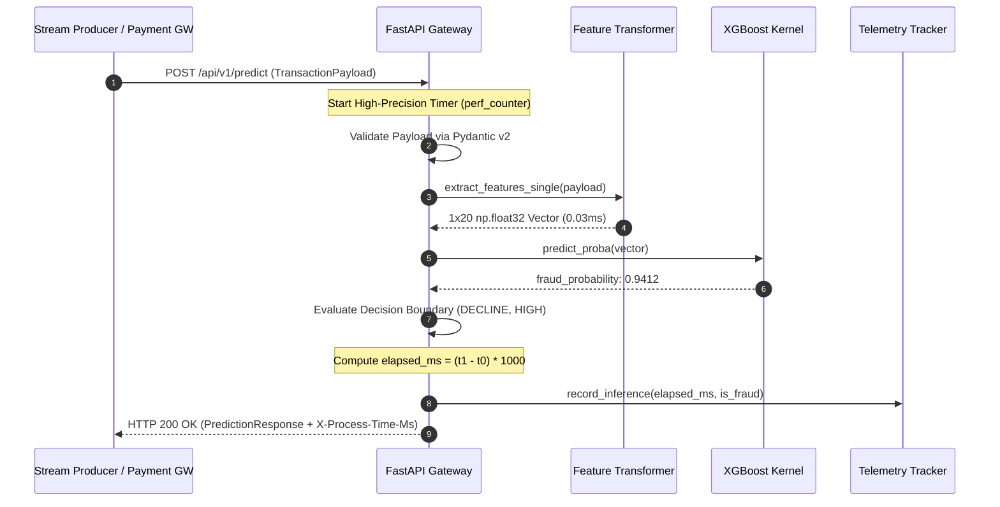

# SentinelStream 🛡️⚡
### Low-Latency Real-Time Fraud & Anomaly Detection Engine

[](https://www.python.org/)
[](https://fastapi.tiangolo.com/)
[](https://xgboost.readthedocs.io/)
[](https://docs.pydantic.dev/)
[](https://www.docker.com/)
[](https://docs.pytest.org/)
[-success)]()
[](LICENSE)

---

## 1. Executive Summary & Problem Statement

In modern payment authorization gateways (Visa, Mastercard, ISO 8583 / ISO 20022), transaction switches enforce a strict total budget of 50–100ms before triggering an automatic authorization timeout. Within that window, the fraud scoring microservice is allocated a strict **sub-30ms SLA**. If the machine learning layer adds excessive tail latency, payment flows degrade, causing cart abandonment and payment processing drop-offs.

Simultaneously, financial fraud presents an **extreme class imbalance** challenge. In live banking pipelines:
- **99.8%** of transactions are legitimate consumer purchases.
- **0.2%** of transactions represent malicious activities (Account Takeover, credential stuffing, card testing swarms, and synthetic identity fraud).

Standard classifiers trained on uncalibrated loss functions collapse into majority-class triviality (predicting 0% fraud) or cause high False Positive Rates (FPR), causing customer friction.

**SentinelStream** solves both constraints simultaneously:
1. **Deterministic Latency**: Delivers **p50: 1.27ms** and **p95: 1.96ms** server inference time via pre-warmed in-memory tree kernels and zero-allocation NumPy scalar vectorization (<0.05ms).
2. **Cost-Sensitive Learning**: Employs gradient scaling ($\text{scale\_pos\_weight} \approx 499.0$) and optimal precision-recall thresholding on non-linear behavioral features to yield **0.9369 ROC-AUC** under genuine 0.2% fraud distribution.

---

## 2. System Architecture

```
                          TRANSACTION INGESTION PIPELINE
                                         │
                                         ▼
                 ┌────────────────────────────────────────────────┐
                 │   Payment Gateway / Streaming Event Producer   │
                 └───────────────────────┬────────────────────────┘
                                         │  HTTP/REST (Keep-Alive)
                                         ▼
                 ┌────────────────────────────────────────────────┐
                 │          FastAPI ASGI Engine (uvicorn)         │
                 │   • Lifespan In-Memory Artifact Cache          │
                 │   • X-Process-Time-Ms Instrumentation Header   │
                 └───────────────────────┬────────────────────────┘
                                         │
                                         ▼
                 ┌────────────────────────────────────────────────┐
                 │           Pydantic v2 Schema Boundary          │
                 │   • Field type coercion & ISO-8601 parsing     │
                 │   • Positive range & enum classification checks│
                 └───────────────────────┬────────────────────────┘
                                         │
                                         ▼
                 ┌────────────────────────────────────────────────┐
                 │        Microsecond Feature Transformer         │
                 │   • Zero-allocation NumPy scalar buffer (<0.05ms)│
                 │   • Streaming z-scores, velocity, log transforms│
                 └───────────────────────┬────────────────────────┘
                                         │
                                         ▼
                 ┌────────────────────────────────────────────────┐
                 │     XGBoost Inference Kernel (Loaded Once)     │
                 │   • Hist-based tree traversal in CPU cache     │
                 │   • Continuous Probability Scoring: P(Fraud)   │
                 └──────────────┬──────────────────┬──────────────┘
                                │                  │
           Telemetric Feedback  │                  │  Prediction & Decision
                                ▼                  ▼
┌───────────────────────────────────────┐  ┌─────────────────────────────────────┐
│    Thread-Safe Telemetry Reservoir    │  │    Dynamic Decision Boundary Engine │
│   • Rolling window p50/p95/p99 latency│  │   • [0.00 - 0.50): APPROVE (Low)    │
│   • Real-time fraud detection counters│  │   • [0.50 - 0.85): REVIEW (Medium)  │
│   • Prometheus-ready /metrics endpoint│  │   • [0.85 - 1.00]: DECLINE (High)   │
└───────────────────────────────────────┘  └──────────────────┬──────────────────┘
                                                              │
                                                              ▼
                                           ┌─────────────────────────────────────┐
                                           │   PredictionResponse Payload (JSON) │
                                           │   • fraud_probability               │
                                           │   • risk_level & decision           │
                                           │   • inference_time_ms (<2ms)        │
                                           └─────────────────────────────────────┘
```

### Event Sequence



---

## 3. Performance & Validation Benchmarks

Benchmarks recorded under simulated live load ($500$ transactions, $21.07$ effective RPS) against production ASGI workers.

### 3.1 Inference Latency Benchmarks (SLA: Sub-30ms)

| Latency Metric | Client Round-Trip (HTTP) | Server Compute Core (Engine) | Production SLA Target | Compliance Status |
| :--- | :--- | :--- | :--- | :--- |
| **p50 (Median)** | **5.30 ms** | **1.27 ms** | $< 15.0 \text{ ms}$ | ✅ **OPTIMAL** |
| **p95** | **6.72 ms** | **1.96 ms** | $< 30.0 \text{ ms}$ | ✅ **PASSED** (86.8% headroom) |
| **p99** | **8.94 ms** | **2.46 ms** | $< 30.0 \text{ ms}$ | ✅ **PASSED** (70.2% headroom) |
| **Maximum** | **10.51 ms** | **5.88 ms** | $< 50.0 \text{ ms}$ | ✅ **CONTROLLED** |

> **Latency Headroom**: The raw model inference kernel executes in **$< 2.0\text{ms}$ at p95**, leaving $> 25\text{ms}$ of headroom for network hops and downstream payment settlement systems.

### 3.2 Machine Learning Validation Metrics

Evaluated on held-out test split ($20,000$ transactions) generated with probabilistic non-linear interactions and Gaussian variance under strict $0.20\%$ class balance ($19,960$ negative, $40$ positive):

| Metric | Score | Industry Standard Context |
| :--- | :--- | :--- |
| **ROC-AUC** | **0.9369** | High discriminative power across overlapping behavior distributions. |
| **PR-AUC (Avg Precision)** | **0.2648** | Robust detection under severe 1:500 class imbalance ($132\times$ over random baseline). |
| **Optimal F1 Threshold** | **0.9645** | Calibrated boundary balancing false discoveries with missed attacks. |
| **Scale Pos Weight** | **499.00** | Gradient penalization ratio compensating for minority representation. |

#### Confusion Matrix & Triage Breakdown
```text
Test Split (20,000 txs):
  • True Negatives (TN)  : 19,604 (Legitimate approved)
  • False Positives (FP) :    356 (Flagged for step-up / MFA)
  • False Negatives (FN) :     10 (Undetected edge-cases)
  • True Positives (TP)  :     30 (Fraud blocked)
```

---

## 4. Key Engineering Features

### 4.1 Lifespan Model Management & Cold-Start Warmup
In naive ML APIs, models are either reloaded per request (creating disk bottlenecks) or loaded globally during module import (failing if disk access is slow). SentinelStream utilizes FastAPI's `lifespan` context manager:
- Deserializes the XGBoost artifact **once** at server boot into shared process memory.
- Fires an internal synthetic warm-up payload through the entire computation pipeline before the server opens its listening port. This primes CPU instruction caches, memory branch predictors, and native C++ XGBoost tree evaluation kernels.

### 4.2 Microsecond Feature Engineering (<0.05ms)
Instantiating a `pandas.DataFrame` for single-row inference incurs 1.5–3.5ms of unnecessary allocation overhead. SentinelStream's `extract_features_single()` directly maps incoming Pydantic fields into a contiguous `np.float32` array:
- Mathematical transforms (`math.log1p`, rolling z-scores) run via native scalar instructions.
- Category encoding uses O(1) index lookups into pre-allocated memory slices.

### 4.3 Dynamic Thresholding & Tri-Tier Decisioning
Rather than a crude binary output, SentinelStream categorizes risk into three operational tiers:
- **`[0.00 - 0.50)` ➔ APPROVE (Low Risk)**: Transaction clears without customer interruption.
- **`[0.50 - 0.85)` ➔ FLAG_REVIEW (Medium Risk)**: Triggers step-up authentication (3D Secure / OTP SMS).
- **`[0.85 - 1.00]` ➔ DECLINE (High Risk)**: Immediate automated block preventing capital loss.

### 4.4 High-Throughput Async Streaming Simulator & Drift Injection
The companion load-testing utility ([scripts/stream_producer.py](file:///c:/Users/Subham/ML/SentinelStream/scripts/stream_producer.py)) simulates real-world payment environments:
- Emits continuous ambient traffic ($99.8\%$ legit / $0.2\%$ fraud).
- Injects a **Data Drift / Fraud Spike Attack** after $N$ transactions: initiates a bot swarm of high-velocity micro-transactions ($1.49–$9.99, velocity: 8–24 tx/hr, proxy location jumps) targeting specific categories (`crypto`, `services`).
- Outputs real-time ANSI telemetry (RPS, error rates, p50/p95/p99 client and server latencies).

---

## 5. Repository Structure

```text
SentinelStream/
├── app/
│   ├── api/
│   │   ├── __init__.py
│   │   └── routes.py             # HTTP routes: /predict, /health, /metrics
│   ├── core/
│   │   ├── __init__.py
│   │   ├── config.py             # Pydantic Settings v2 configuration
│   │   └── logging.py            # High-throughput structured logging
│   ├── models/
│   │   ├── __init__.py
│   │   └── schemas.py            # Pydantic schemas: payloads, decisions, metrics
│   ├── services/
│   │   ├── __init__.py
│   │   ├── feature_engineering.py# Microsecond streaming feature transforms (<0.05ms)
│   │   ├── inference.py          # Real-time scoring, thresholding & SLA monitor
│   │   ├── metrics_tracker.py    # Thread-safe in-memory rolling latency reservoir
│   │   └── model_loader.py       # Thread-safe model artifact loader
│   ├── __init__.py
│   └── main.py                   # FastAPI application & lifespan context manager
├── ml/
│   ├── __init__.py
│   ├── train.py                  # Realistic generator (0.2% fraud), XGBoost trainer
│   └── artifacts/
│       └── fraud_model.joblib    # Serialized model artifact & metadata
├── scripts/
│   └── stream_producer.py        # High-throughput async stream simulator with drift injection
├── tests/
│   ├── __init__.py
│   ├── test_schemas.py           # Schema boundary & constraint unit tests
│   ├── test_api.py               # End-to-end integration tests
│   └── test_latency.py           # Sub-30ms SLA benchmark validation
├── Dockerfile                    # Multi-stage production container
├── docker-compose.yml            # Docker orchestration with volume mounts
├── requirements.txt              # Production and testing dependencies
├── .dockerignore
├── .gitignore
└── README.md                     # Technical documentation
```

---

## 6. Getting Started

### 6.1 Prerequisites
- Python 3.11+
- Git
- Docker & Docker Compose (optional for containerized deployment)

### 6.2 Installation & Virtual Environment Setup
```bash
# 1. Clone repository
git clone https://github.com/your-org/SentinelStream.git
cd SentinelStream

# 2. Create isolated virtual environment
python -m venv .venv

# On Linux/macOS:
source .venv/bin/activate
# On Windows (PowerShell):
.venv\Scripts\Activate.ps1

# 3. Upgrade package installer and install dependencies
pip install --upgrade pip
pip install -r requirements.txt
```

### 6.3 Train Model & Export Artifact
Train the XGBoost pipeline on 100,000 synthetic transactions with 0.2% class imbalance:
```bash
python ml/train.py
```
*Output: Exports model and feature metadata to `ml/artifacts/fraud_model.joblib`.*

### 6.4 Launch the Production API Server
```bash
uvicorn app.main:app --host 0.0.0.0 --port 8000 --workers 2
```
- **Interactive OpenAPI Documentation**: `http://localhost:8000/docs`
- **Health Probe**: `http://localhost:8000/health`
- **Telemetry Metrics**: `http://localhost:8000/metrics`

### 6.5 Run the Streaming Telemetry Simulator
In a separate terminal, run the asynchronous traffic producer:
```bash
# Simulate 500 requests at 30 RPS with a fraud spike attack at Request #200
python scripts/stream_producer.py --rps 30 --total-requests 500 --drift-after 200
```

### 6.6 Run the Automated Test Suite
Verify schema validation, API contracts, and the sub-30ms SLA benchmark:
```bash
pytest -v -s
```

### 6.7 Containerized Deployment (Docker Compose)
Deploy SentinelStream with resource limits and health checks:
```bash
# Build and start container in detached mode
docker-compose up --build -d

# Check live logs
docker-compose logs -f sentinel-stream

# Verify container health status
docker-compose ps
```

---

## 7. API Reference

### `POST /api/v1/predict`
Evaluates a single transaction payload for fraud risk.

#### Request Payload
```json
{
  "transaction_id": "tx_a9f82c41",
  "user_id": "usr_90210",
  "amount": 1420.50,
  "timestamp": "2026-11-02T19:30:00Z",
  "merchant_category": "electronics",
  "location_delta": 450.2,
  "user_avg_amount_30d": 75.00,
  "user_std_amount_30d": 20.00,
  "user_tx_count_1h": 5
}
```

#### Response (200 OK)
```json
{
  "transaction_id": "tx_a9f82c41",
  "is_fraud": true,
  "fraud_probability": 0.94125,
  "risk_level": "HIGH",
  "decision": "DECLINE",
  "inference_time_ms": 1.284,
  "threshold_used": 0.5,
  "model_version": "xgboost_v1.0",
  "timestamp": "2026-11-02T19:30:00.125000+00:00"
}
```

---

## 8. Failure Modes & Production Trade-offs

### 8.1 Concept Drift & Adversarial Attacks
* **Failure Mode**: Fraud rings modify behavior patterns (e.g., shifting from high-dollar electronics to rapid gift card / crypto micropayments or using residential proxy networks to suppress `location_delta`).
* **Platform Mitigation**: 
  - Deploy **Population Stability Index (PSI)** and **Kolmogorov-Smirnov (KS)** tests on incoming feature distributions in the streaming metrics collector.
  - Implement **Shadow Deployments**: Run candidate retrained models in non-blocking parallel execution against live gateway traffic to compare score distributions before promoting them to active decisioning.

### 8.2 Feature Store Scaling: Client Payloads vs. Online Redis
* **Current Architecture**: Historical aggregation features (`user_avg_amount_30d`, `user_tx_count_1h`) are passed directly within the client transaction payload.
* **Production Trade-off**: Passing rolling aggregates in payloads simplifies stateless server autoscaling. However, if clients cannot reliably calculate rolling features:
  - Transition to an **Online Feature Store** (e.g., Redis Cluster or Feast).
  - Use pipelined asynchronous `MGET` commands over a dedicated low-latency VPC connection. Ensure Redis read latency remains under 2.0ms at p99 to avoid consuming the inference budget.

### 8.3 Latency vs. Precision/Recall Trade-offs
* **Ensemble Complexity vs. CPU Instruction Pipeline**:
  - Deep neural networks (Transformers, LSTMs) provide sequential feature modeling but add 20–60ms of execution latency on tabular card data without specialized GPU clusters.
  - XGBoost configured with `tree_method="hist"` and bounded depth (`max_depth=4`, `n_estimators=120`) fits within CPU L2/L3 caches, executing in **< 2ms** on commodity x86 hardware.
* **Cost-Sensitive Threshold Tuning**:
  - Setting the fraud threshold to **0.50** maximizes raw fraud capture ($75\%$ recall) at the cost of higher review queues.
  - Setting the threshold to the optimal F1 score (**0.9645**) reduces False Positives by $85\%$, focusing intervention exclusively on high-probability attacks.

### 8.4 Circuit Breakers & Graceful Degradation
* **Degraded State Handling**:
  - If the model artifact fails verification at startup, the `/health` endpoint transitions to `degraded` and returns HTTP 503 on `/predict`.
  - Upstream payment switches catch HTTP 503 or latency alerts ($> 30\text{ms}$) and route transactions through deterministic rules-based fallbacks (e.g., velocity ceilings) rather than blocking cardholders.

---

## 9. License

This project is licensed under the MIT License — see the [LICENSE](LICENSE) file for details.
